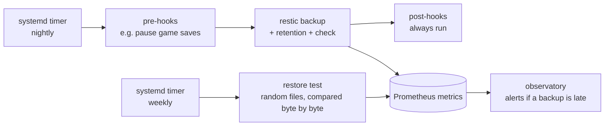

# safekeep

Encrypted, deduplicated backups with [restic](https://restic.net), plus the part most setups skip:
**proving the backup can actually be restored**, every week, automatically.



## Features

- **One command:** `safekeep backup | restore-test | status | snapshots | init`
- **Retention:** daily / weekly / monthly, pruned after every run
- **Restore tests:** restores random files from the latest snapshot, compares them with the live files and reads 5 % of the raw pack data to catch silent corruption
- **Hooks:** executable scripts in `hooks/pre.d` and `hooks/post.d`; post-hooks run even when a backup fails
- **Monitoring:** writes Prometheus metrics (last success, duration, exit code, snapshot count, repo size) for the node_exporter textfile collector
- **Alerts:** optional healthchecks.io-style dead-man's switch and Discord message on failure
- **Safe by default:** lock file against overlapping runs, hardened systemd units, config never overwritten on reinstall

## Install

```bash
sudo apt install restic jq curl
sudo ./install.sh                       # binary, config skeleton, systemd timers
sudo $EDITOR /etc/safekeep/backup.env
sudo safekeep init
sudo safekeep backup
sudo safekeep status
```

`install.sh` generates a random repository password in `/etc/safekeep/restic.password`.
**Keep a copy somewhere else.** Without it the backups cannot be decrypted.

## Metrics

```text
safekeep_backup_last_success_timestamp_seconds{tag="mc-01"} 1762654512
safekeep_backup_last_duration_seconds{tag="mc-01"} 41
safekeep_backup_last_exit_code{tag="mc-01"} 0
safekeep_snapshots{tag="mc-01"} 23
safekeep_repository_size_bytes{tag="mc-01"} 5368709120
safekeep_restore_test_last_success_timestamp_seconds{tag="mc-01"} 1762567200
```

The matching alert rules (`BackupTooOld`, `RestoreTestFailing`) live in [observatory](https://github.com/antony-bdc/observatory).

## Tests

`make test` runs an end-to-end test against a throwaway local repository (no root needed):
init, two backups, excludes, hooks, metrics, restore test, failing hooks, wrong password and concurrent runs.
CI runs it together with `shellcheck` on every push.

## Design decisions

- **A backup is only as good as its last restore.** That's why the restore test is a first-class command with its own timer and metric, not an afterthought.
- **Failures must be loud.** Bash silently disables `set -e` inside `cmd || handler` lists, so the run is wrapped in a dedicated subshell with errexit re-enabled. A test checks that a wrong password really fails the run.
- **Metrics are written atomically** (temp file + `mv`), and a failed run keeps the previous *last success* time, so a "backup too old" alert stays correct.
- **Bash, not a framework.** restic does the hard part; the wrapper stays small enough to read in one sitting.

---

Part of my homelab series → [bastion](https://github.com/antony-bdc/bastion) · [dwellers-galaxy](https://github.com/antony-bdc/dwellers-galaxy) · [observatory](https://github.com/antony-bdc/observatory)
